# External measurement board

As part of the CARROTS project, we develop a MMC prototype using the OwnTech Suite. WP1 develops the hardware prototype. WP2 and WP3 use this prototype to develop and test decentralized control and communication.

To do classic MMC closed-loop control, it is necessary to have external measurement boards to measure the DC voltage $u_{dc}$, DC current $i_{dc}$, phase voltage $v_{p}$, phase current $i_{p}$ and arm currents $i_{u,l}$. Also, the MMC start-up require a resistance + relay system on the DC/AC sides for current limitation. Figure 1 shows the necessary measurements outside of the modules and the position of the correspondent external measurement boards.

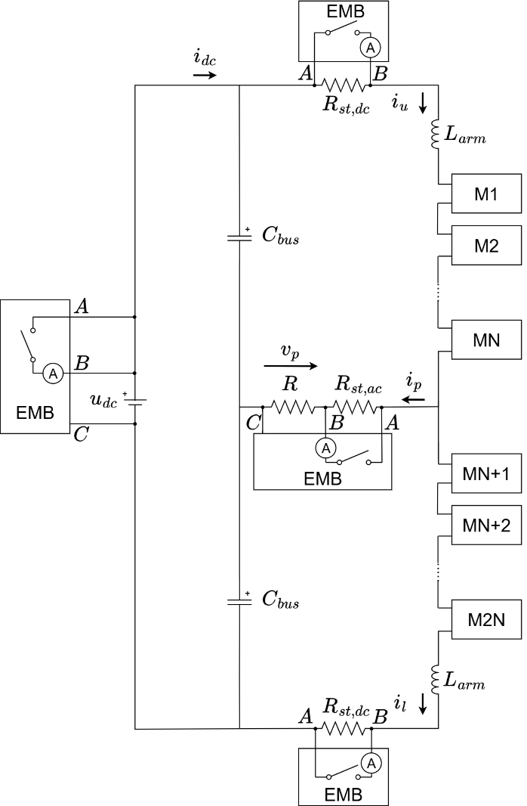

# Board structure

The external measurement board general structure is represented in Figure 2. It is composed of a power and a digital part separated by a galvanic isolation. The power part circuit is shown in Figure 3. It is composed of a power relay, 2 voltage measurements and 1 current measurement. The connectors A-B side is called "upstream" and connectors C-D side is called "downstream". The digital part is composed of a microcontroller (SPIN) that reads the measurements and sends to the controller and other modules via RS485 communication.

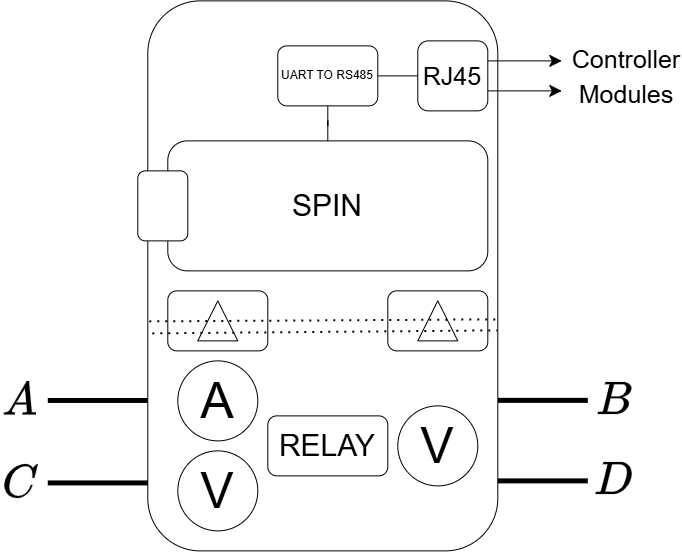

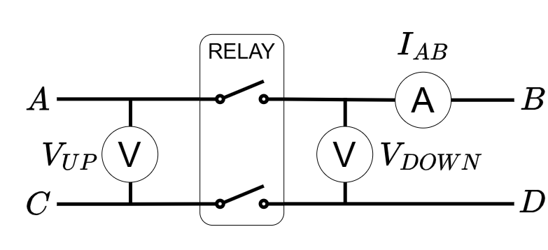

# KiCad schematic development

## Power circuit

The power part of the external measurement board is composed of a solid state relay that connects upstream side to downstream side, connectors that connects to the converter circuit and voltage/current sensors.

**Questions left for discussion:**

- **For now I have kept the backplane structure as used for the modules for compatibility, but we also evoked the possibility of using banana connectors.**
- **Added a 1 MΩ resistor R282 between PUPGND and PDOWNGND, so the two grounds are at the same voltage before the relay closes.**

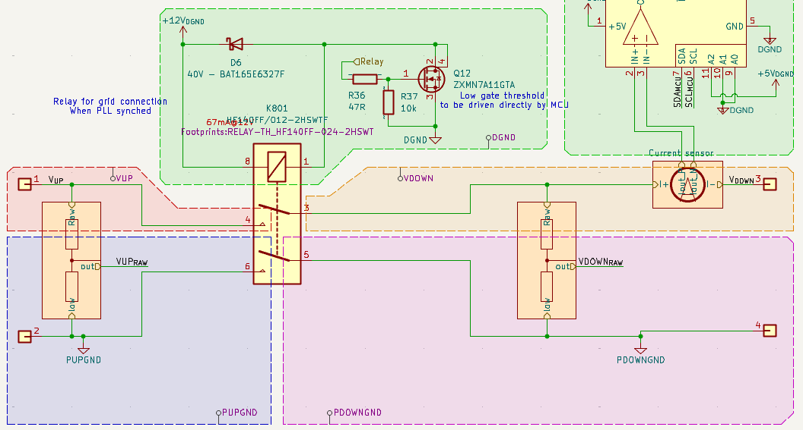

## Voltage and current sensors

The measurement solution is the same used in the new module board. The voltage raw measurement is acquired using a voltage divisor. The current raw measurement is acquired by an IC current sensor.

Then, both raw measurements are amplified and sent to the digital part of the board using a galvanic isolated amplifier.

Finally, the voltage and current measurements are treated by an analog front-end that is able to change the sensor gain, offset and resolution according to the application.

**Questions left for discussion:**

- **What is the role of the SDA_MCU and SCL_MCU signals?**
- **Added 4.7 k pull-ups R431/R432 on SCL_MCU/SDA_MCU, taken from the PEBB project. The I²C pull-ups go to 5 V, so need to check if the STM32G474 pins PA13/PA14 are 5 V-tolerant. If not, use 3.3 V?**
- **The divider is now R280 = 15 k and R281 = 10 k, from PEBB.**
- **Added a 1 nF ACS724 filter capacitor (C493).**
- **The current sensor is now the specific ACS724LLCTR-50AB-T part.**
- **AFE801/802/807: they appear in the BOM with an empty value. Exclude them from the BOM? They have a individual KiCad project?**

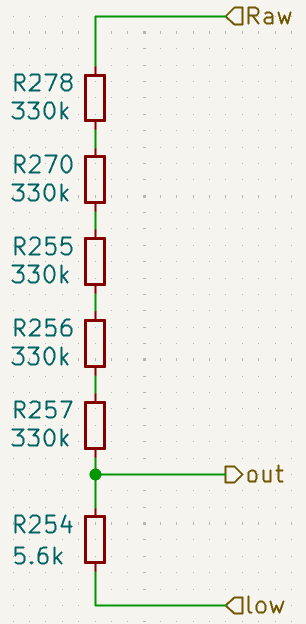

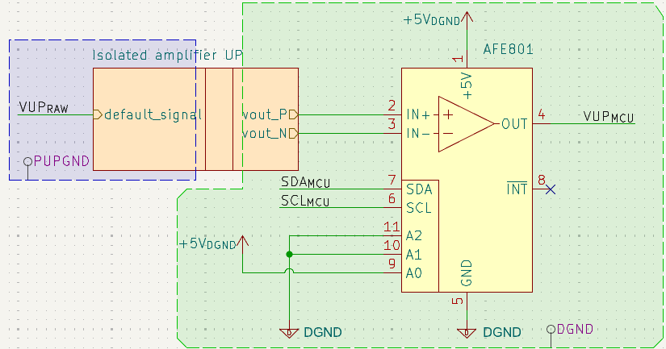

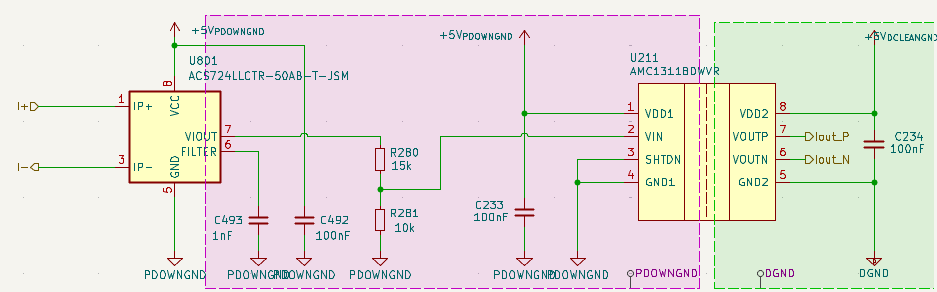

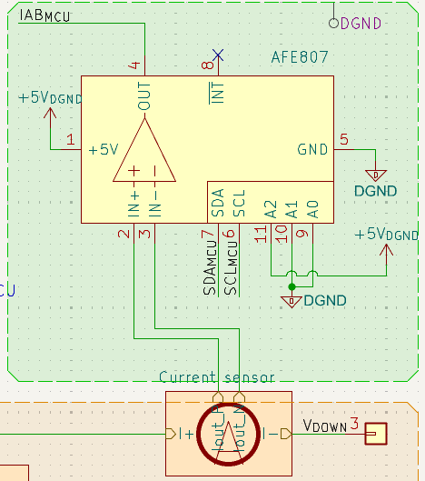

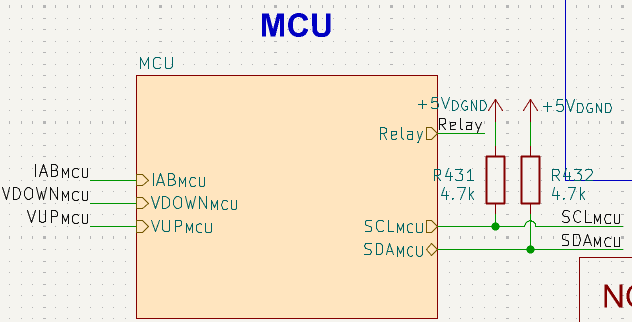

## SPIN

The SPIN is the microcontroller part of the board. The SPIN from OwnVerter solution is kept but some changes on the pinout were necessary:

- Adapt the pins to the measurements we implemented (Vup, Vdown, IAB)

- Add a command for the relay

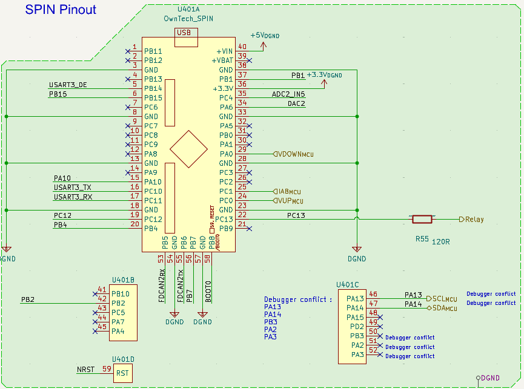

## Communication

The RS485 communication is used to communicate the boards measurement with the controller/other modules of the converter. It can also receive commands to open/close the switch.

CAN and analog communications are also included in the schematic since they are a part of the base OwnTech solution.

The communication RJ45 terminals pins order are modified from latest board versions (TWIST V1.4.3 and OWNVERTER V1.1) to be correspondent to the pins used in the WP4 redesigned modules.

**Questions left for discussion:**

- **A adaptation to communicate with previous board versions is then necessary?**
- **J813: C2902697 is a single RJ45; the symbol and footprint are a dual RJ45 with LEDs.**
- **Termination relays RS485 and CAN: replaced the ASSR-1218 (DIP-4) with the GAQY221S (SOP-4). The LED resistors R406/R407 went from 120 Ω to 680 Ω.**
- **RJ45 LED resistors: R403/R405 went from 3 k to 330 Ω.**
- **The 120 Ω terminations can never switch on. TERM120 only goes to J813 pin 12, which is an LED pin, and to the LED inputs of U820/U821. No MCU pin drives it. The same applies to Power_EN, Module_{Status} and USB_{STATUS}t. Add this according to PEBB implementation?**
- **CAN transceiver: replaced the TCAN334GDR (3.3 V part, 5 V absolute maximum) with the CA-IF1051S, which runs from the 5 V supply.**
- **Leftover symbol for CAN: U402 still uses the TCAN334 symbol (pin names SHDN/STB) and U405 the LTC2850 one. The pinouts match, so this is only cosmetic.**
- **RS485 transceiver: set to the CA-IF4850HS (3.0–5.5 V supply), replacing the LTC2850 (3.3 V only).**
- **D403 of Analog: changed to BAS40DB, as in PEBB.**
- **Changed R401, R406, R407, R410, R412, C401 and C410 footprints to 0603 to match their LCSC parts.**

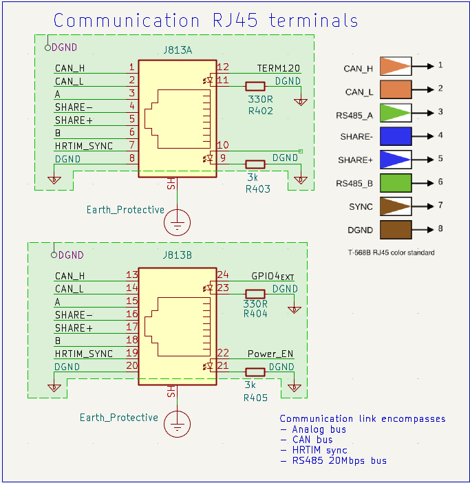

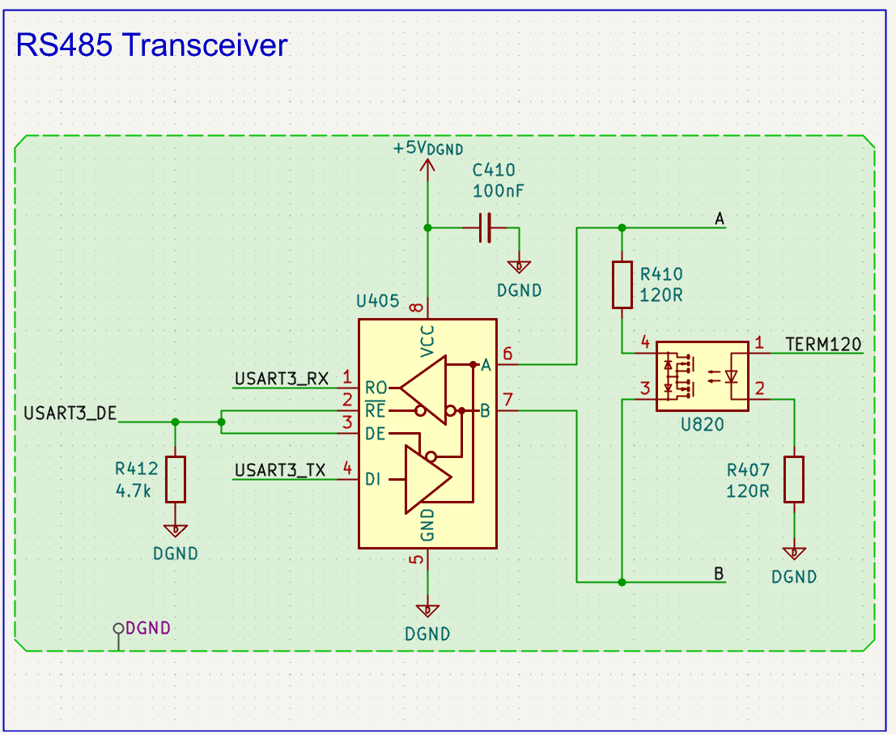

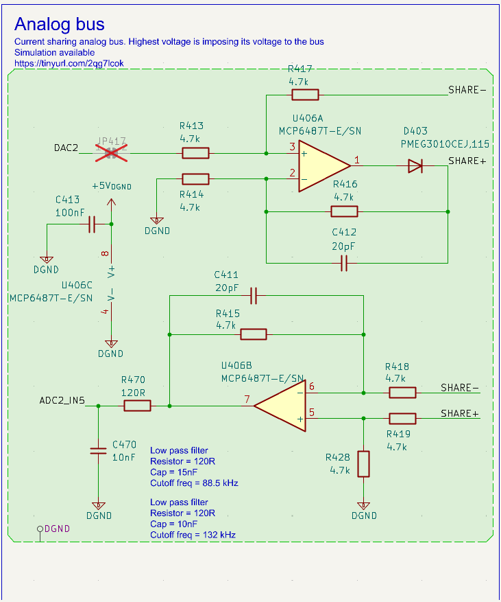

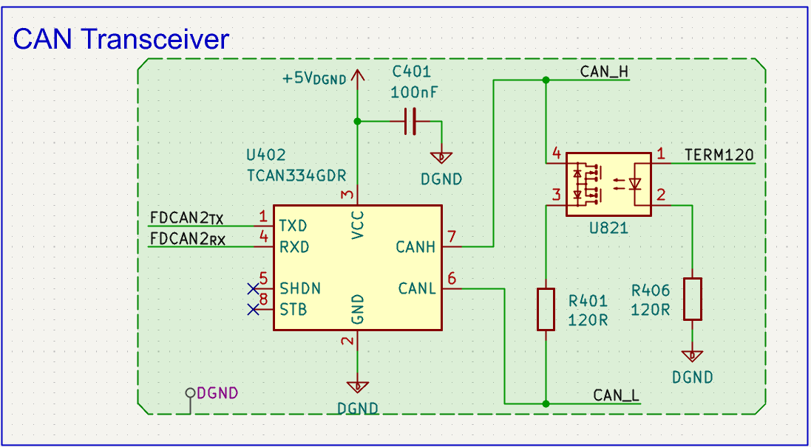

## Auxiliary circuits supply

We adapted the auxiliary circuits supply feed generation of the microinverter project <https://github.com/owntech-foundation/micro-inverter>. The auxiliary circuits are fed by 5 VDGND, 5 VPUPGND and 5VPDOWNGND derived by the 12 VDGND input. The 12 VDGND input must be supplied by an external DC source.

The TPS7420 linear voltage regulator is used on the output of all +5V feeds to filter signal noises and keep the output on the target 5 V voltage.

**Questions left for discussion:**

- **12 V input: the connectors are now the HC-MX3.0-2*1AW (Micro-Fit compatible) and the fuse is the SMD1210-035-16V.**
- **Isolated auxiliary supplies: replaced the VPT87DDF01B/CMT88 transformer with the CMT8830U (ratio 1:1.13:1.13).**
- **Its datasheet recommends it for the CMP6503S, and the higher ratio gives the 5 V LDOs more input voltage.**
- **D7–D10: the PMEG3010BEA is SOD-323 but the footprint is SOD-323F. The pads are close, but it's worth matching them.**
- **L5: C3002596 is a CKST0402 with 126 mΩ; the value says 80 mΩ and the footprint is CKCS4020.**
- **Need to update the notes on consumption of the the supply circuits.**

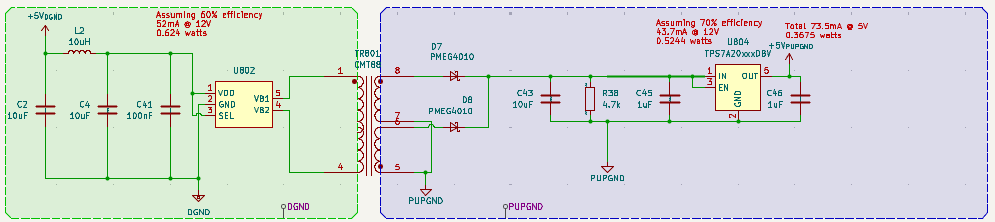

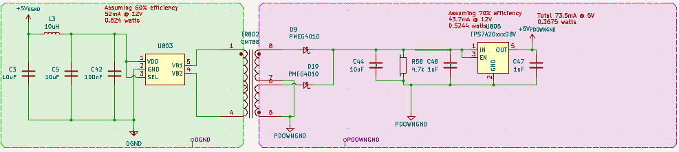

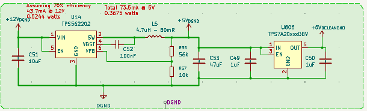

## Datasheets referencing

There still some elements that have different datasheets reference (in PEBB too) compared to their LCSC number. Also there are some datasheets that are not specified:

**Datasheet referenced does not correspond to the LCSC part:**

- U405 (CA-IF4850HS, C7422579): datasheet points to the LTC2850 (Analog Devices). The symbol is also still the LTC2850xS8.
- C205, C206, C211, C212, C233, C234, C401, C410, C413, C492 (100nF, C14663 - Yageo CC0603KRX7R9BB104): datasheet is the KEMET C1002 X7R series.
- C493 (1nF, C1588 - Samsung CL10B102KB8NNNC): datasheet is the KEMET C1002 X7R series.
- C411, C412 (20pF, C1648 - Samsung CL10C200JB8NNNC): datasheet is the Yageo NP0 general purpose series.
- R249, R250, R251, R252, R254, R255, R256, R257, R258, R269, R277, R278, R280, R281, R282, R401, R402, R403, R404, R405, R406, R407, R410, R412, R413, R414, R415, R416, R417, R418, R419, R428, R431, R432, R470 (UniOhm 0603WAF/0805W8F parts): datasheet is the Bourns CR series.

**Datasheet not specified:**

- Capacitors: C2, C3, C4, C5, C41, C42, C43, C44, C45, C46, C47, C48, C49, C50, C51, C52, C53
- Inductors: L2, L3, L5
- Resistors: R36, R37, R38, R55, R56, R57, R58
- Connectors: J813 (RJ45 x2), U809 (PwrBlade 51722-10602-0020)

Mounting holes (H1 to H6), solder jumpers (JP406, JP410, JP417) and the Eurocard rails (N101) do not need a datasheet.

## BOM referencing

- C410: the footprint is still 0805, but C14663 is an 0603 part. You changed C401's footprint but not C410's.
- J813: C2902697 is a single RJ45; the symbol and footprint are a dual RJ45 with LEDs.
- L5: C3002596 is a CKST0402 with 126 mΩ; the value says 80 mΩ and the footprint is CKCS4020.
- No LCSC number: R249 and R254 (5.6 k 0805), and U809 (its value is also ~).
- AFE801/802/807: they appear in the BOM with an empty value. Either exclude them from the BOM like U401, or give them a value.
- Leftover symbols: U402 still uses the TCAN334 symbol (pin names SHDN/STB) and U405 the LTC2850 one. The pinouts match, so this is only cosmetic.
- D7–D10: the PMEG3010BEA is SOD-323 but the footprint is SOD-323F. The pads are close, but it's worth matching them.

# KiCad Layout

## General structure

The board PCB has a structure divided in two parts, digital (upper) and power (lower), separated by a isolation area of 8 mm as defined by the IEC 60664 standard.

The board dimensions are reduced to 100mmx100mm compared to the usual 100mmx160mm of the OwnVerter/Twist boards.

The board keeps the same railtracks and mount holes for mechanical fixation as the OwnVerter/Twist boards. The 4 lower mount holes positions where adapted to position a safety bow around the board power part, avoiding user direct contact.

In the following sections, certain components positioning details are defined.

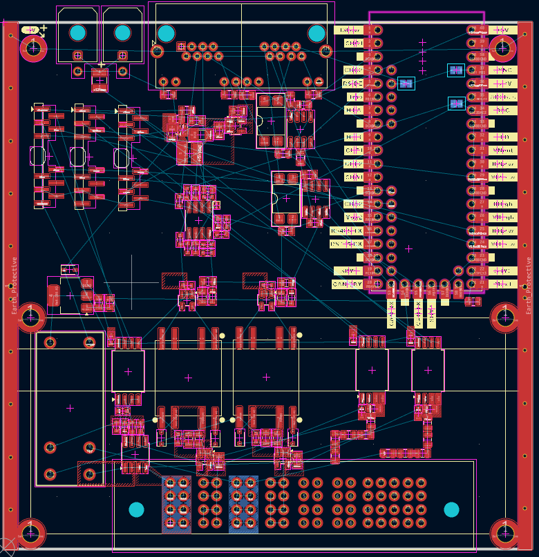

## Relay

The relay and its activation circuit on digital-side are shown in Figure 18. The relay is placed across the isolation area.

The activation circuit is placed in a certain distance from the relay to allow the placement of the security box.

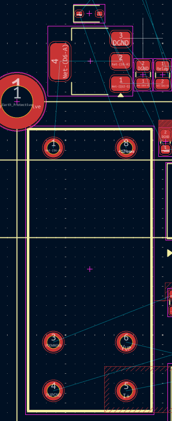

##  Auxiliary supply for PUPGND/PDOWNGND referenced components

The CMT8830U power transformer is used to isolate the 5 VDGND to 5 VPUPGND/5 VPDOWNGND. The CMP6503S isolated power transformer driver is used to drive the transformer. In its datasheet, its recommended positioning with respect to the transformer is as shown in Figure 19.

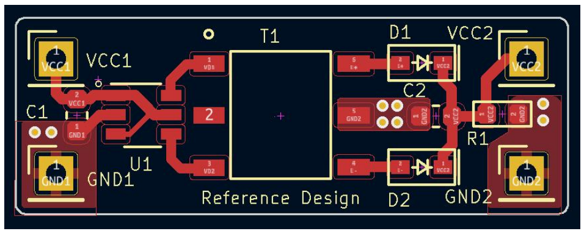

The TPS7420 linear voltage regulator is used on the output of all +5V feeds to filter signal noises and keep the output on the target 5 V voltage. In its datasheet, its recommended positioning with respect to the input and output capacitors is as shown in Figure 20.

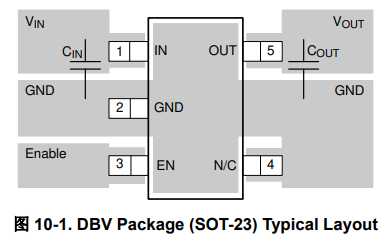

With the guidance of these datasheets indications the placement for the PDOWNGND referenced side was implemented as shown in Figure 21. The driver circuit is distanced from the transformer to allow the placement of the security box.

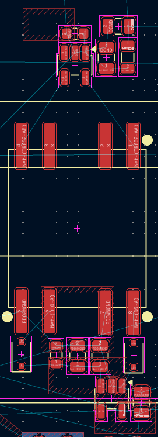

The placement for the PUPGND part is similar, but the buck circuit was moved to under the switch due to lack of space in the layout power part.

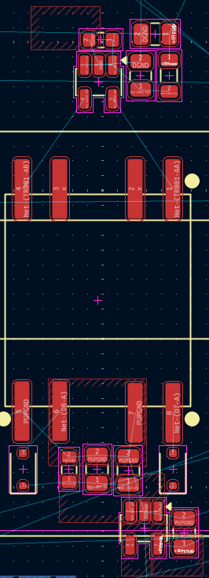

## Auxiliary supply for DGND referenced components

To pass from 12 VDGND to 5 VDGND voltage, the TPS562202 buck converter is used. The positioning of the commutation cell with respect to the other buck components are done as suggested in the datasheet as shown in Figure 23.

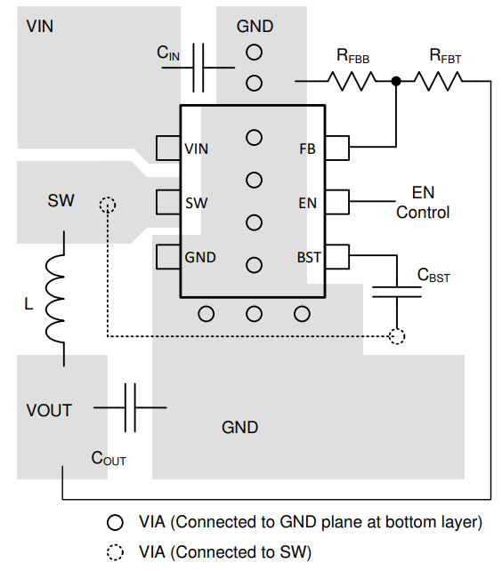

The TPS7420 linear voltage regulator is used on the output of all +5V feeds to filter signal noises and keep the output on the target 5 V voltage. In its datasheet, its recommended positioning with respect to the input and output capacitors is as shown in Figure 20.

The 5VDGND generation layout is shown in Figure 25.

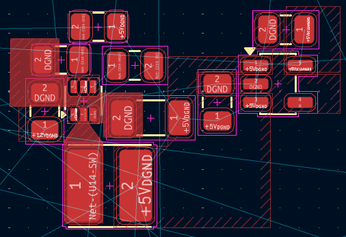

## Voltage measurement circuit

The AMC1311x isolated amplifier is used to isolate the raw measurement of the power side from the digital measurement that is used by the MCU. In its datasheet, its recommended positioning with respect to the voltage divisor, input RC filter and decoupling capacitors is shown in Figure 26.

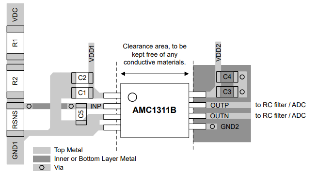

With the guidance of these datasheets indications the placement for both PUPGND/PDOWNGND referenced side was implemented as shown in Figure 27. The resistors where placed to avoid letting different potentials close to each other.

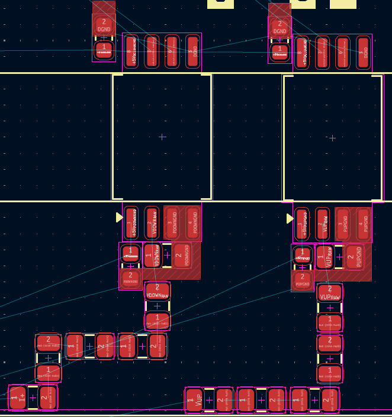

The analog-front end gets this digital output from the amplifier and adapts it according to user set gain, offset and resolution. The placement of the analog front-end for the 2 voltage measurements and current measurement was kept near the top part of the board as in the module boards developed by WP4, shown in Figure 28.

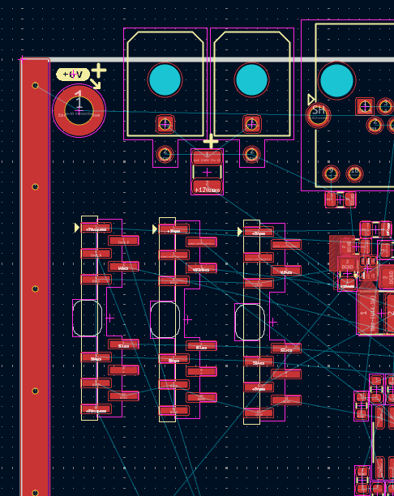

## Current measurement circuit

The ACS724 isolated current sensor is used to acquire the raw current measurement passing from A to B connectors of the board. There is no recommended layout position in its datasheet, so the components where placed as close as possible to the pins. To have a smaller current path, the current sensor was placed the closest as possible to the relay I+ pin and VDOWN connector.

Similarly to the voltage measurement, the AMC1311x isolated amplifier is used to isolate the raw measurement of the power side from the digital measurement that is used by the MCU. In its datasheet, its recommended positioning with respect to the voltage divisor, input RC filter and decoupling capacitors is shown in Figure 26.

With the guidance of these datasheets indications, the placement of the current measurement circuit was implemented as shown in Figure 29.

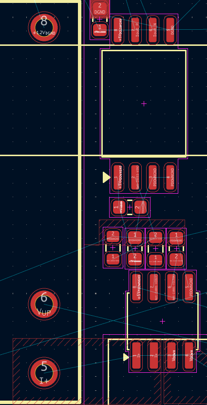

# Wiring development

## +12VDGND, +5VDGND, +5VPUPGND and +5VPDOWNGND feeding

The components feeding in the digital part was concentrated in the In2 layer. The widths of each one were estimated using the KiCad width calculator considering $\Delta T = 10 °C$ and H = 35 µm.

### +12VDGND width

To the left side, the +12VDGND input supplies the MOSFET that drives the relay and the realy. The relay consumption of the 12 V input is of 67 mA according to the microinverter project notes. Given this, we estimated:

| Current (A) | Conductor length (mm) | Calculated width (mm) |
|:-------------------------------:|:---------------------:|:---------------------:|
|0.067|72|0.0188|

To give a safety marge for the relay consumption and to use TWIST/SPIN usual values for feeding traces width, we used 0.25 mm width for the conductor feeding the relay + relay MOSFET.

To the right side, the +12VDGND input supplies all the other digital side components, since it feeds the +5VDGND and +5VDCLEARGND and the power side comonents, since the +5VDGND feeds the +5VPUPGND and +5VPDOWNGND. We make a list of its main components consumption in current:

| Component | Current (mA) |
|:----------|:-----------:|
| **+5VPUPGND loads** (fed through U802 + TR801 + U804) | |
| U205 AMC1311 isolated amplifier high-side supply (IDD1) | 9.7 |
| R38 transformer pre-load (5 V / 4.7 kΩ) | 1.1 |
| *Subtotal +5VPUPGND* | *10.8* |
| **+5VPDOWNGND loads** (fed through U803 + TR802 + U805) | |
| U207 AMC1311 isolated amplifier high-side supply (IDD1) | 9.7 |
| U211 AMC1311 isolated amplifier high-side supply (IDD1) | 9.7 |
| U801 ACS724 current sensor (ICC) | 15 |
| R58 transformer pre-load (5 V / 4.7 kΩ) | 1.1 |
| R280 + R281 divider on ACS724 output | 0.2 |
| *Subtotal +5VPDOWNGND* | *35.7* |
| **+5VDCLEANGND loads** (fed through U806) | |
| U205 AMC1311 isolated amplifier low-side supply (IDD2) | 8.1 |
| U207 AMC1311 isolated amplifier low-side supply (IDD2) | 8.1 |
| U211 AMC1311 isolated amplifier low-side supply (IDD2) | 8.1 |
| AFE801, AFE802, AFE807 analog front-ends (estimate, all three) | 100 |
| *Subtotal +5VDCLEANGND* | *124.3* |
| **+5VDGND loads** (fed by U14 buck) | |
| U401 SPIN (estimate) | 100 |
| U402 CA-IF1051S CAN transceiver | 80 |
| U405 CA-IF4850HS RS485 transceiver (driving 54 Ω) | 70 |
| U406 MCP6487 dual op-amp (2 × 0.72 mA) | 1.4 |
| R431 + R432 I2C pull-ups (both lines low) | 2.1 |
| U802 CMP6503S input (+5VPUPGND subtotal, η ≈ 52 %) | 22 |
| U803 CMP6503S input (+5VPDOWNGND subtotal, η ≈ 77 %) | 49.1 |
| U806 TPS7A2050 input (= +5VDCLEANGND subtotal) | 124.3 |
| ***Total +5VDGND*** | ***448.9*** |

The CMP6503S input currents are calculated as $I_{in} = I_{out} \cdot V_{out} / (\eta \cdot V_{in})$, with $V_{out} \approx 5.3$ V after the rectifier and $\eta$ read from the CMP6503S datasheet curves (Fig. 8.7 and 8.11, measured with the CMT6870N transformer). The linear voltage regulators TPS7A2050PDBVR input current is equal to their output current. The TPS562202 input current is calculated as $I_{12V} = I_{5V} \cdot 5.07 / (\eta \cdot 12)$, with $\eta \approx 93 \%$ and $I_{5V} = 448.9$ mA from the TPS562202 datasheet (Fig. 7-14, $V_{in}$ = 12 V, $V_{out}$ = 5 V).

This gives us a total current of 0.204 A for the right side branch.

We also could do a estimation of possible current consumption considering 3 W, which gives 3/12 = 0.25 A, which is very close to the value from the datasheets.

The current of 0.25 A is taken into account since it is the biggest. With this current, we estimated the width:

| Current (A) | Conductor length (mm) | Calculated width (mm) |
|:-------------------------------:|:---------------------:|:---------------------:|
|0.25|23|0.11|

To give a safety marge and to use TWIST/SPIN usual values for feeding traces width, we used 0.5 mm width for the conductor feeding the TPS562202 component.

### +5VDGND width

Since the +5VDCLEARGND consumption is directly connected to +5VDGND with a copper zone, we consider only 324.6 mA consumption to define the wires width.

| Current (A) | Conductor length (mm) | Calculated width (mm) |
|:-------------------------------:|:---------------------:|:---------------------:|
|0.324|19|0.16|

To give a safety marge and to use TWIST/SPIN usual values for feeding traces width, we used 0.5 mm width for the conductor feeding the branches RS485 transceiver + SPIN/CAN + Analog + CMP6503S + transformer D-PUP D-PDOWN.

### +5VPUPGND and +5VPDOWNGND width

As the division of load between the two +5VDGND branches are quite equilibrated, from this point ownwards, we consider 0.5 mm or 0.25 mm width are sufficient.

### +5VDCLEARGND width

The +5VDCLEARGND consumption is 124.3 mA, so we calculate the width.

| Current (A) | Conductor length (mm) | Calculated width (mm) |
|:-------------------------------:|:---------------------:|:---------------------:|
|0.125|137|0.0444|

To give a safety marge and to use TWIST/SPIN usual values for feeding traces width, we used 0.5 mm width for the conductor feeding of the +5VDCLEARGND branches.

The resulting feeding wired for the digital and power side components is given on Figures 30 and 31. The feeding on the digital side is on In2 layer and the feeding on the power side is on In1 layer.

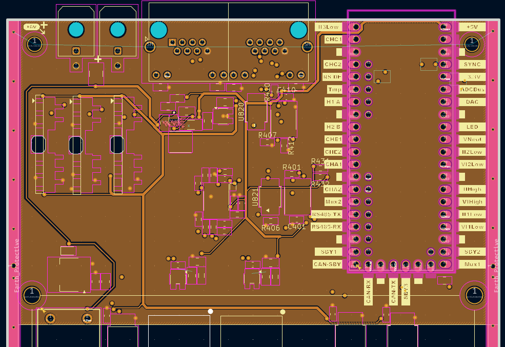

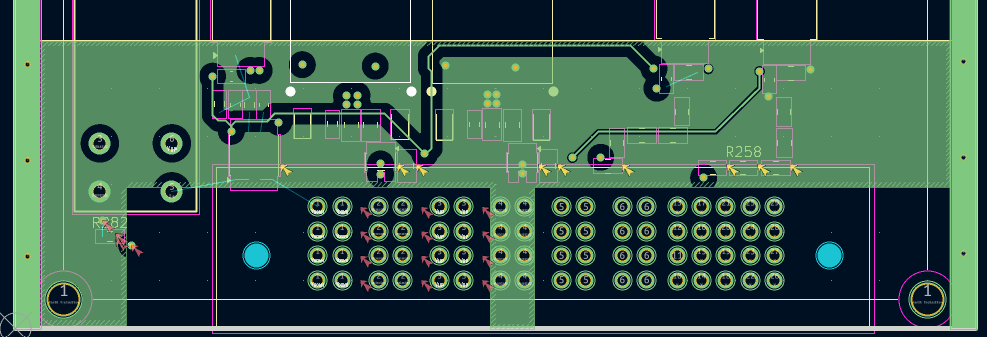

## Power circuit

The power circuit composed by relay + current and voltage measurements (see Figure 4) needs to have its wiring compatible to the current passing by each branch.

### VDOWN to current sensor

Considering MMC module ratings for the CARROTS project, the maximum current is 10 Apeak. Considering this current and the length from VDOWN terminal to the current sensor:

| Current (A) | Conductor length (mm) | Calculated width (mm) |
|:-------------------------------:|:---------------------:|:---------------------:|
|10|10|18.7|

Using a copper plane of 17 mm width (Y axis) and 10 mm length (X axis), we do a path between VDOWN terminal and the current sensor as in Figure 32.

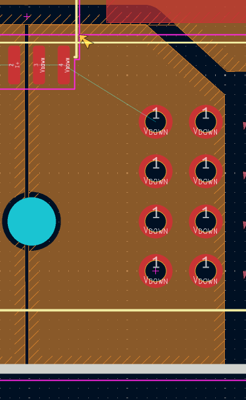

### Current sensor to relay

Considering the same current and the length from the current sensor to the relay:

| Current (A) | Conductor length (mm) | Calculated width (mm) |
|:-------------------------------:|:---------------------:|:---------------------:|
|10|8.45|18.7|

Using a copper plane of 17 mm width (Y axis) and 22 mm length (X axis), we do a path between the current sensor and the relay as in Figure 33.

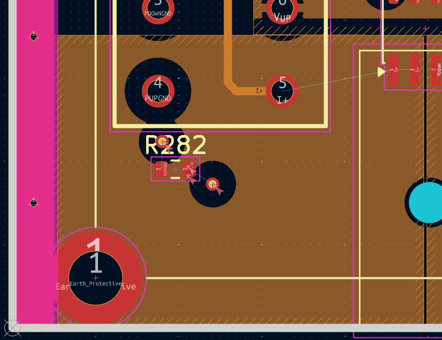

### Relay to VUP terminal

Considering the same current and the length from the relay to VUP terminal:

| Current (A) | Conductor length (mm) | Calculated width (mm) |
|:-------------------------------:|:---------------------:|:---------------------:|
|10|30|18.7|

Using a copper plane of 17 mm width (Y axis) and 45 mm length (X axis), we do a path between the relay and the VUP terminal as in Figure 33.

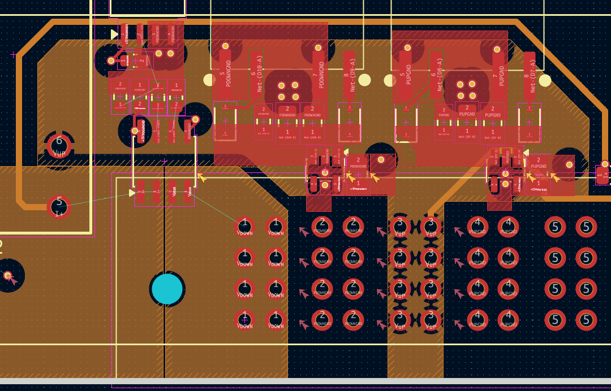

### Voltage measurement voltage divider

The path to the voltage measurement voltage divider consumes some current from the main current path. Considering worst can scenario where VUP or VDOWN voltage peak is 800 V, the current demand is related to the voltage divider total impedance (see Figure 5).

Using that $R = 5 \cdot 0.33 = 1.65 M \Omega$, the current demand would be $I = \frac{800}{1.65\cdot 10^6}=0.485$ mA

Using the calculator again with this current and the lengths between the relay and the voltage dividers:

| Current (mA) | Conductor length (mm) | Calculated width (um) |
|:-------------------------------:|:---------------------:|:---------------------:|
|0.485|72|20.9|
|0.485|32|20.9|

We use 0.5 mm width for safety margin. The resulting wiring for the power circuit is given on Figure 35.

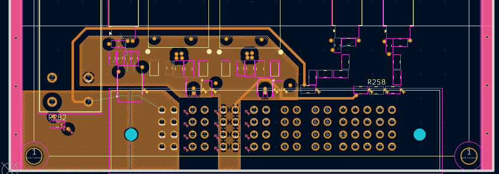

## Signals

All other signals are wired in the front and bottom layers. The resulting wiring is shown in Figure 36.

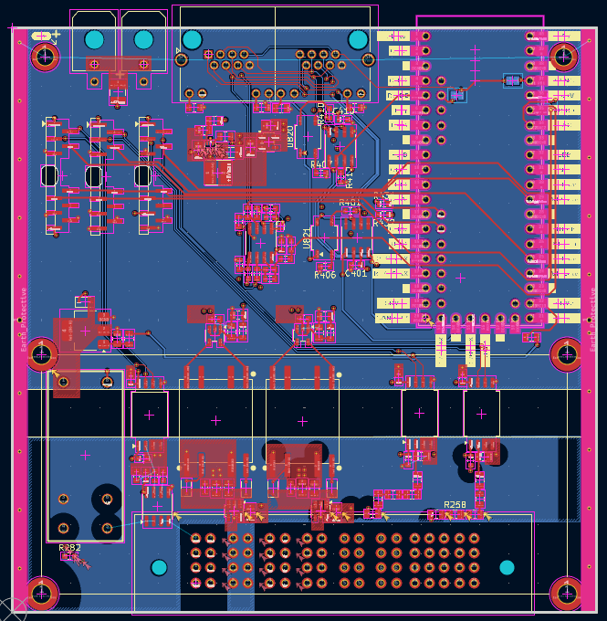

## Used vias

**To confirm with Jean which size we can use for the vias of TPS562202**

## Layers copper thickness

**To confirm with Jean if it is 35 µm or other (according to manufacturer)**